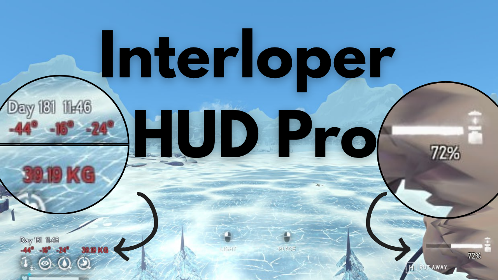

## Interloper Hud Pro

Interloper Hud Pro is a mod for The Long Dark FPS survival game.

Interloper HUD Pro enhances your survival experience on Great Bear Island by adding vital stats directly to your HUD — including:
* Date & Time
* Real-time Temperature
* Inventory Weight
* Movement Speed
* Active Item Condition
* Breaking ice timer
* Thin ice timer
* Wind tracker

Stay informed. Stay alive.

## 📊 Features
| Feature | Description |
|----------|--------------|
| 🕒 **Day & Time** | Displays the in-game day and time |
| 🌡️ **Temperature** | Shows `Air Temp` / `Wind Chill` / `Feels like` temperatures Temperature text turns red when your body temperature drops below zero  This is absolutely critical info at Interloper / Misery difficulty to avoid: * 20%/hr cold damage * Hypothermia |
| 🎒 **Inventory Weight** | Keeps track of your current carry load Weight text turns red while encumbered |
| 🏃 **Movement Speed** | Displays your current horizontal movement speed in real time |
| 🔧 **Active Item Condition** | Shows your held item’s remaining durability at a glance Especially useful to squeeze the most value out of torches and other fragile tools |
| 🧊 **Ice-Breaking Time** | Extends the selected fishing hole clearing tool name with the estimated time required to break the ice |
| ❄️ **Thin Ice Break Timer** | Displays the remaining time before thin ice breaks under your feet |
| 💨 **Wind Tracker** | Displays a wind direction arrow relative to the player, wind speed text, or both depending on your selected display mode The wind tracker can optionally remain visible indoors, where the arrow spins instead of showing a real direction |
| ⚖️ **Automatic Weight Units** | Carried weight is displayed in `KG` or `LBS` depending on the game's measurement unit setting |
| 🌬️ **Automatic Wind Speed Units** | Wind speed is displayed in `KM/H` or `MPH` depending on the game's measurement unit setting |
| 🏃 **Automatic Movement Speed Units** | Movement speed is displayed in `KM/H` or `MPH` depending on the game's measurement unit setting |
| 🎛️ **HUD Customization** | Includes optional per-category customization settings to reposition HUD elements and adjust element sizes where supported |
| 🖱️ **Visual Layout Editor** | Move every display with the mouse directly in game, including displays that are currently disabled |

## ⚙️ Configuration

### Displayed Information
You can individually enable or disable the following HUD elements:

| Option | Description |
|----------|--------------|
| **Show air temperature** | Displays the current outdoor temperature |
| **Show wind chill** | Displays the temperature penalty caused by the wind |
| **Show feels like temperature** | Displays the final temperature you actually feel after clothing and effects are applied |
| **Wind HUD display mode** | Choose whether to show nothing, the wind arrow only, the wind speed only, or both |
| **Show wind HUD indoors** | Keeps the selected wind HUD visible indoors |
| **Show carried weight** | Displays your current carried weight |
| **Show movement speed** | Displays your current movement speed |
| **Show day and time** | Displays the current day and time above the main HUD block |
| **Show held item condition** | Displays the condition of the item currently held in your hands |
| **Show ice-breaking time** | Displays the estimated time needed to clear an ice fishing hole next to the selected tool |
| **Show thin ice break time** | Displays the remaining time before thin ice breaks under your feet |

### HUD Customization
Each HUD category has its own **Customize ... HUD** toggle. Enabling one reveals only the settings related to that category.

| Option | Description |
|----------|--------------|
| **Visual layout editor key** | Key that opens the visual layout editor in game (default `F8`) |
| **Air temperature X / Y position** | Moves the air temperature display left/right and up/down |
| **Wind chill X / Y position** | Moves the wind chill display left/right and up/down |
| **Feels like temperature X / Y position** | Moves the feels like temperature display left/right and up/down |
| **Wind HUD X position** | Moves the wind tracker left or right |
| **Wind HUD Y position** | Moves the wind tracker up or down |
| **Wind arrow size** | Adjusts the size of the wind direction arrow |
| **Wind speed size** | Adjusts the size of the wind speed text |
| **Wind speed Y offset** | Adjusts the vertical spacing between the wind arrow and the wind speed text |
| **Carried weight position** | Moves the carried weight display left or right |
| **Movement speed X position** | Moves the movement speed display left or right |
| **Movement speed Y position** | Moves the movement speed display up or down |
| **Movement speed size** | Adjusts the size of the movement speed text |
| **Held item condition position** | Moves the held item condition display left or right |
| **Thin ice timer size** | Adjusts the font size of the thin ice timer |
| **Thin ice timer vertical offset** | Moves the thin ice timer farther below the warning panel |

### 🖱️ Visual Layout Editor
Press the **Visual layout editor key** (default `F8`, set in ModSettings → *HUD Customization*) while playing to open the editor.

* Every display is shown while the editor is open, even the ones that are disabled, so they can all be placed
* Only positions are edited: sizes, colors and visibility settings cant be edited in this editor
* Every display can be placed anywhere on screen, except the held item condition and the thin ice timer which stay attached to their vanilla widgets
* Positions are saved into the same settings as the ModSettings sliders and stay within their ranges, so both ways of editing stay in sync
* Open the editor while the **First Aid** panel is open to move the **Vitamin C** widget  

| Control | Action |
|----------|--------------|
| **Mouse drag** | Moves the display under the cursor |
| **Arrow keys** | Nudges the selected display by 1 (hold `Shift` for 10) |
| **Tab** | Selects the next display |
| **R** | Resets the selected display to its default position |
| **Shift + R** | Resets every display to its default position |
| **Enter** / editor key | Saves and closes the editor |
| **Backspace** | Cancels every change made since the editor was opened and closes it |

Editable displays are highlighted in blue, the display under the cursor in light yellow and the selected display in orange, with its name shown above it.

| Note | Description |
|----------|--------------|
| **Single-axis displays** | Wind speed (distance below the arrow, it follows the wind tracker wherever it is placed) and the thin ice timer move vertically only, the held item condition moves horizontally only |
| **Held item condition** | Can only be moved while an item is held, since it lives in the equipped item popup |
| **Game time** | The game keeps running while the editor is open, open it somewhere safe |
| **Menus** | Opening a menu or closing the First Aid panel closes the editor and keeps the changes |

### Wind Tracker Options

| Option | Description |
|----------|--------------|
| **Wind HUD display mode** | Selects whether the wind tracker shows nothing, arrow only, speed only, or both |
| **Show wind HUD indoors** | Keeps the selected wind tracker elements visible indoors |
| **Indoor wind spin speed** | Adjusts how fast the indoor wind arrow spins |
| **Indoor wind spin direction** | Lets you choose clockwise or counter-clockwise rotation indoors |

## 🧩 HUD Placement Notes
| Element | Description |
|----------|--------------|
| **Main HUD block** | Temperature, weight, and movement speed are displayed together above the vanilla cold meter area |
| **Day & Time** | Shown above the main HUD block |
| **Wind Tracker** | Displayed as its own HUD block, with the direction arrow above the wind speed text when both are enabled |
| **Held Item Condition** | Displayed near the equipped item popup |
| **Thin Ice Timer** | Displayed below the vanilla thin ice warning widget |
| **Vitamin C** | Displayed in the First Aid panel, next to the calorie widget |

## Installation

1. Install MelonLoader.
2. Install [ModSettings](https://github.com/DigitalzombieTLD/ModSettings/).
3. Place `InterloperHudPro.dll` inside your Mods folder.
